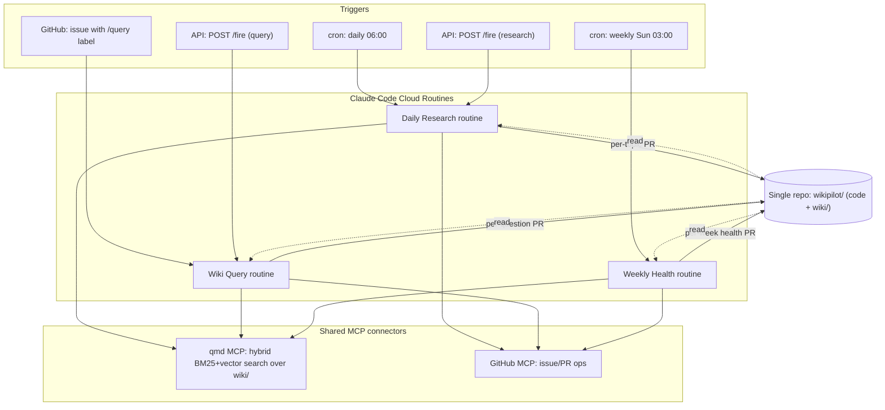
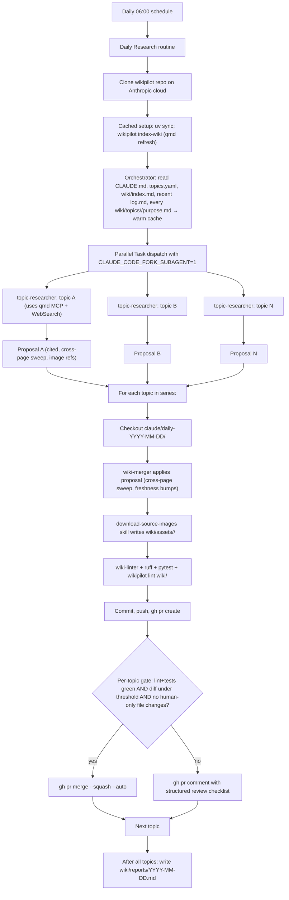
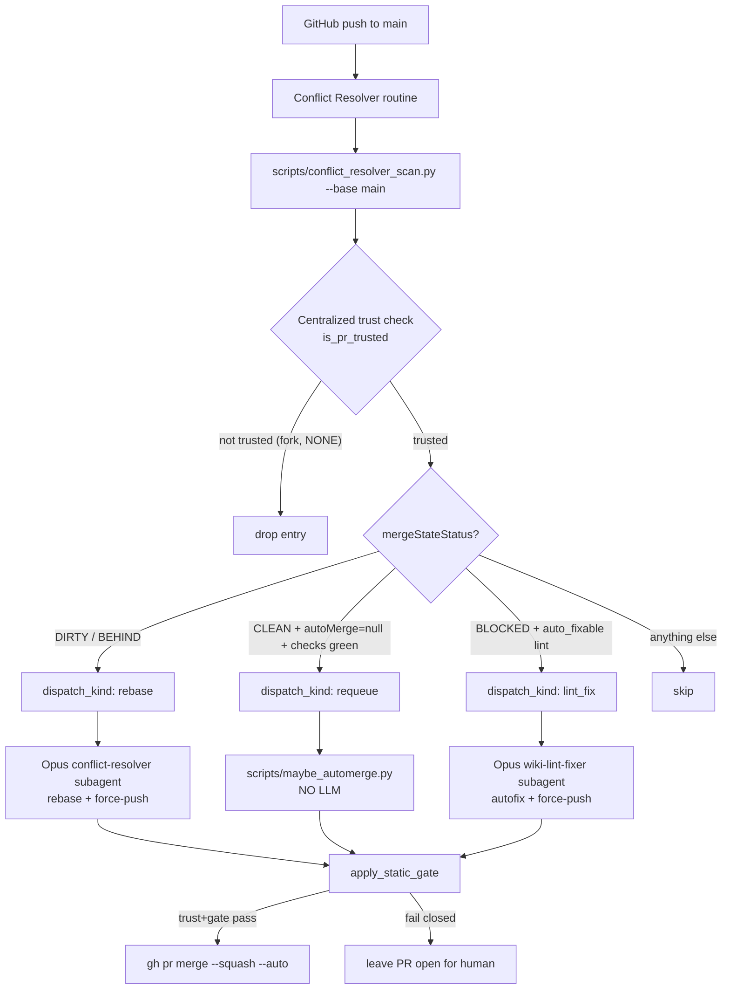

# Architecture

Wikipilot is a single-repo, Obsidian-friendly wiki maintained by three [Claude Code Cloud Routines](https://docs.anthropic.com/en/docs/claude-code/web-scheduled-tasks). All compute happens on Anthropic's infrastructure; Obsidian runs locally over the same git-versioned `wiki/` directory.

## Multi-routine system overview

Three routines share the same repo, the same agents, and the same MCP connectors. Each produces a different shape of PR.



## Daily Research routine: per-topic loop

The most complex of the three. Topic researchers fan out in parallel (sharing the orchestrator's prompt cache via `CLAUDE_CODE_FORK_SUBAGENT=1`), then mergers run in series to produce one PR per topic.



## Conflict Resolver routine: unified stuck-PR fixer

The fourth routine runs separately from the three content producers. It exists to catch the small fraction of PRs that, despite the in-routine `maybe_automerge.py` call AND the end-of-run `wikipilot recover-prs` net, still ended up stuck waiting for an automated fix. Three failure modes, one scan, three handlers:



The `lint_fix` triage runs `wikipilot.git_ops.classify_lint_failure` over the failing workflow's log (fetched via `gh run view --log-failed`, capped at 200 KB). The classifier returns `auto_fixable: true` only when every failing category is in `[automerge.conflict_resolver].auto_fix_lint_categories` (default: `broken-wikilink`, `broken-image-ref`, `frontmatter`, `log-format`) AND no hard blocker is present (`ownership-violation`, pytest failure, unknown category). Anything else falls through to "leave for human" — the auto-fix path is deliberately bounded so the worst-case is "we did nothing", never "we silently corrupted the wiki".

Layer 6 catches the cause-2 failure class (broken-wikilink from slug-mismatch) **upstream** so the lint-fixer rarely needs to fire for it: the `topic-researcher` emits a deterministic `slug` field per source in its Proposal, and the `wiki-merger` validates every wikilink against the union of `known_slugs(vault) | proposal_slugs` via `wikipilot.wikilinks.resolve_or_fix_in_files` BEFORE committing. Unresolvable links abort the topic with a structured error in the run report; auto-fixable typos are silently rewritten in place using the same shared library the lint and the lint-fixer use.

## Repo layout

```text
wikipilot/
├── README.md
├── CLAUDE.md                       # the wiki schema (single source of truth)
├── AGENTS.md                       # pointer to CLAUDE.md for non-Claude tools
├── pyproject.toml                  # uv-managed deps, ruff, pytest config
├── topics.yaml                     # human-owned: list of topics
├── wikipilot.toml                  # human-owned: per-route auto-merge thresholds, image policy
├── .claude/
│   ├── agents/                     # 5 subagent definitions (added in Phase 2)
│   └── skills/                     # 8 skill manifests (added in Phase 2)
├── prompts/                        # 3 routine prompts (added in Phases 4, 6, 7)
├── wiki/                           # the Obsidian vault — content source of truth
│   ├── index.md                    # catalog (LLM-write, human-read)
│   ├── log.md                      # chronological append-only
│   ├── topics/<id>/                # topic landing page + human-owned purpose.md
│   ├── concepts/                   # cross-topic concept pages
│   ├── entities/                   # people/projects/orgs
│   ├── sources/                    # one .md per ingested URL
│   ├── answers/                    # Wiki Query answer pages
│   ├── reports/                    # daily and weekly run reports
│   ├── decks/                      # `wikipilot deck` Marp output
│   └── assets/<source-slug>/       # downloaded images
├── src/wikipilot/                  # Python core
├── scripts/                        # operational scripts
├── tests/                          # pytest suite
└── docs/                           # design docs and runbooks
```

## File ownership matrix

The wiki only stays maintainable if it's clear who owns each file. The Python lint enforces this; the auto-merge gate blocks any `claude/*` branch that touches a human-only file.

- **Human-only**: `topics.yaml`, `CLAUDE.md`, `AGENTS.md`, `wikipilot.toml`, `prompts/`, `wiki/topics/<id>/purpose.md`, `README.md`, `LICENSE`, `.claude/`, `docs/`
- **LLM-only**: `wiki/index.md`, `wiki/log.md`, `wiki/sources/`, `wiki/reports/`, `wiki/answers/`, `wiki/decks/`, `wiki/assets/`
- **Mixed**: `wiki/topics/<id>/index.md`, `wiki/concepts/`, `wiki/entities/`

See [`CLAUDE.md`](../CLAUDE.md) for the full conventions, frontmatter contract, citation discipline, and per-agent model assignments.

## Tool entity profile (benchmark scout feed)

The user runs a monthly benchmark of generative tools for game creators (2D art, 3D, animation, rigging, audio). The wiki is its scout: before each round a script diffs the wiki's tool registry against the benchmark's model registry. To make that diff deterministic, generative tools are **entity pages with a machine-readable `profile: tool` block** — `kind` stays `entity` so every existing code path (comparisons, cross-page sweep, index sections, agent prompts) keeps working; `profile` is a discriminator.

```yaml
---
title: "Meshy"
kind: entity
aliases: ["Meshy AI", "Meshy 7"]
sources: ["[[meshy-7-is-live-higher-fidelity-image-to-3d-generation-with-ultra-mode-f27c1d9b]]"]
last_updated: 2026-10-24
last_verified: 2026-10-24
freshness_window_days: 30
profile: tool
modality: 3d                       # [tool_profiles].modalities
tasks: ["image-to-3d", "text-to-3d"]
vendor: "Meshy"
model_ids: ["meshy-7", "fal:fal-ai/meshy/v7"]   # unprefixed = vendor id; `fal:` / `replicate:` = aggregator endpoint
access: ["api", "fal"]             # non-empty list; [tool_profiles].access_values (api, fal, replicate, open-weights, web, desktop, none, unknown)
open_weights_license: unknown
hardware_floor: unknown
pricing: unknown                   # "<amount>/<unit> (<date>)" when known
pricing_source: null
commercial_use: unknown            # "<terms> (<date>)" when known
commercial_use_source: null
status: active                     # [tool_profiles].status_values
status_source: "[[meshy-7-is-live-higher-fidelity-image-to-3d-generation-with-ultra-mode-f27c1d9b]]"
last_release: 2026-08-05           # ISO date or unknown
arena_rank: []                     # ["<board>: <rank> (<date>)", ...]
arena_rank_source: []              # same length as arena_rank
---
```

Design decisions:

- **Every field present, `unknown` when unsourced, never guessed.** The lint rule `tool-profile` (error) enforces presence and enum membership; it cannot be auto-fixed because the fixer would have to invent a value.
- **Lists where reality is multi-valued.** `access` (a model is often open-weights *and* on fal), `model_ids` (vendor id plus aggregator endpoints), `arena_rank` (one tool on several boards). `arena_rank_source` is a parallel list so each board claim has its own citation.
- **Tracked fields.** `[tool_profiles].tracked_fields` (`status`, `pricing`, `commercial_use`, `arena_rank`) each carry a `_source` sibling. These are what the roster sweep re-confirms daily and what `tool-changes` diffs.
- **Derived roster.** `wikipilot.toml` is human-owned, so a static roster would never include a tool the researcher proposes in a `page_diff`. `[tool_profiles.modality_topics]` maps modality → owning topic; the per-topic roster is computed at run time by `wikipilot.tools.tools_for_topic`.

### Scout interface (`wikipilot tools`, `wikipilot tool-changes`)

Both commands are pure Python over frontmatter + `git show`; zero LLM tokens. Both emit `schema_version: 1` and follow an **additive-only contract**: new keys may appear, existing keys never change meaning or disappear within a major version.

`wikipilot tools [--topic ID] [--modality M] --format json` — the full current registry:

```json
{
  "schema_version": 1,
  "head_rev": "<sha or null>",
  "tools": [
    {
      "slug": "meshy",
      "path": "wiki/entities/meshy.md",
      "title": "Meshy",
      "modality": "3d",
      "tasks": ["image-to-3d", "text-to-3d"],
      "vendor": "Meshy",
      "model_ids": ["meshy-7", "fal:fal-ai/meshy/v7"],
      "access": ["api", "fal"],
      "open_weights_license": "unknown",
      "hardware_floor": "unknown",
      "pricing": "unknown",
      "pricing_source": null,
      "pricing_source_url": null,
      "commercial_use": "unknown",
      "commercial_use_source": null,
      "commercial_use_source_url": null,
      "status": "active",
      "status_source": "meshy-7-is-live-higher-fidelity-image-to-3d-generation-with-ultra-mode-f27c1d9b",
      "status_source_url": "https://www.meshy.ai/blog/meshy-7",
      "last_release": "2026-08-05",
      "arena_rank": [],
      "arena_rank_source": [],
      "arena_rank_source_url": [],
      "last_verified": "2026-10-24",
      "sources": ["meshy-7-is-live-higher-fidelity-image-to-3d-generation-with-ultra-mode-f27c1d9b"]
    }
  ]
}
```

`*_source` values are bare source slugs (the `[[...]]` wrapper is stripped); `*_source_url` is resolved from the source page's `url` frontmatter (`null` when the slug doesn't resolve). The scout's admission check is `any(a in {"api","fal","replicate","open-weights"} for a in tool["access"])`.

`wikipilot tool-changes (--since YYYY-MM-DD | --since-rev SHA) --format json` — what moved since a baseline. `--since-rev` is the natural query for the benchmark (it pins the wiki commit each round read); `--since DATE` resolves to `git rev-list -1 --before=DATE HEAD`.

```json
{
  "schema_version": 1,
  "baseline_rev": "<sha>",
  "head_rev": "<sha>",
  "changes": [
    {
      "entity": "meshy",
      "field": "pricing",
      "old": "unknown",
      "new": "$0.20/generation (2026-11-02)",
      "source_slug": "meshy-pricing-2026-11-...",
      "source_url": "https://www.meshy.ai/pricing",
      "last_verified": "2026-11-02"
    }
  ],
  "new_tools": [ { "...full tool record as in `wikipilot tools`..." } ],
  "removed_tools": ["slug"]
}
```

The markdown rendering of the same diff (`--format md`, default) is the `## Creator tooling changes` section of the daily report (baseline = `main` SHA at run start) and the weekly health report (baseline = 7 days ago).

## Cost shape

- **Daily Research**: O(topics × Opus_cached_prefix × cache_read_multiplier + topics × Opus_proposal_size + topics × Sonnet_merger + topics × Haiku_lint). Opus pricing on `topic-researcher` dominates. Mitigated by `CLAUDE_CODE_FORK_SUBAGENT=1` (shared cached prefix) and `max_sources_per_run` per topic.
- **Wiki Query**: O(1) per question on Opus.
- **Weekly Health**: O(candidate_sets × pages_per_set) on Sonnet — tunable via `K` in `scripts/disputes_seed.py`.

The per-run report (`wiki/reports/YYYY-MM-DD.md` and `health-YYYY-MM-DD.md`) records token usage by model tier, so we can validate the Opus investment with real numbers after Phase 8.
